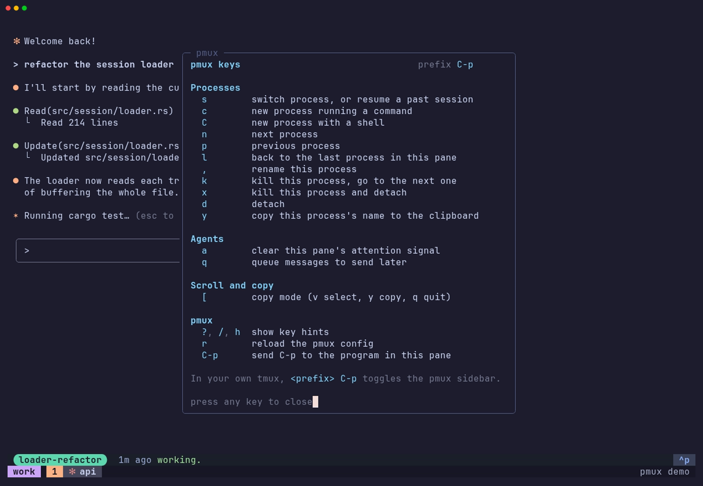
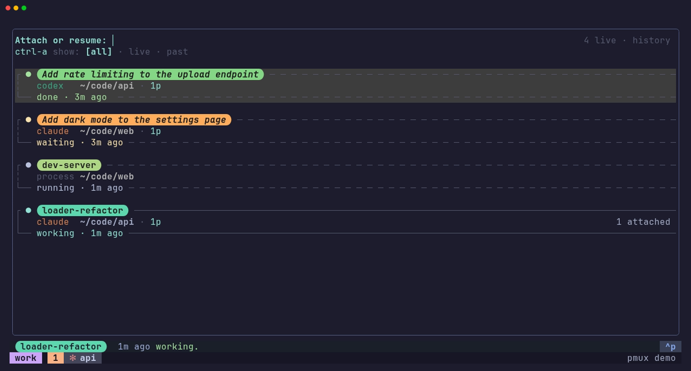
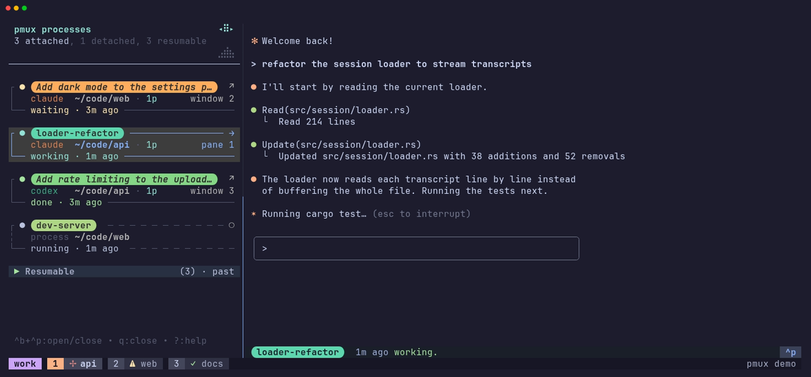

# pmux

`pmux` keeps long-running interactive CLI processes, especially AI agents
like `claude`, `codex`, `cortex`, or `gemini`, alive on their own dedicated
tmux server, separate from your tmux. Detach from one, let it keep working,
and reattach from any terminal or device you SSH in from, or switch between
several from one stable pane, all without touching your tmux layout.

In practice: wrap your agents once (`pmux wrap claude`), keep launching them
the way you always have, press `Ctrl-p d` to detach, and reattach any time
with `pmux a`. With the tmux integration, `prefix + Ctrl-p` opens a sidebar
listing every process and what each agent is doing.


## Contents

- [Requirements](#requirements)
- [Install](#install)
- [First-time setup](#first-time-setup)
- [Typical usage](#typical-usage)
- [The pmux sidebar](#the-pmux-sidebar)
- [Optional add-ons](#optional-add-ons)
- [Documentation](#documentation)
- [Development](#development)
- [License](#license)

## Requirements

- tmux 3.3a or newer
- Bash or Zsh for command wrappers (Fish gets completions with
  `pmux completions fish`, but no wrappers)
- `curl` or `wget`, and `sha256sum` or `shasum`, for the installer
- Rust 1.88 or newer, only to build from source

See the [optional add-ons](#optional-add-ons) section for additional requirements per optional feature.

## Install

```sh
curl -fsSL https://raw.githubusercontent.com/cosmicbuffalo/pmux/main/install.sh | sh
```

<details>
<summary>What the installer does</summary>

- Downloads the release binary for your platform (Linux or macOS), checks it
  against the release's SHA-256 checksums, and installs it to
  `~/.local/bin/pmux`. Make sure `~/.local/bin` is on your `PATH`.
- Release binaries carry GitHub build provenance. With an authenticated
  [`gh`](https://cli.github.com/) on `PATH`, the installer verifies it with
  `gh attestation verify` and refuses a binary that fails; without `gh`, it
  prints the command to run yourself. `PMUX_VERIFY_ATTESTATION=1` makes the
  check mandatory and `0` skips it.
- Runs `pmux init`, which adds a marked block to your shell rc file
  (`~/.zshrc`, `~/.bashrc`, or `~/.profile`) for completions and wrappers.
  `PMUX_SKIP_INIT=1` skips it; the uninstaller removes it.
- Checks your tmux is 3.3a or newer. If yours is new enough but reports an
  unusual version string, `PMUX_SKIP_TMUX_CHECK=1` skips the check.
- `PMUX_VERSION=v0.1.0` pins a release instead of the latest.
- Read the full script at [install.sh](install.sh).

</details>

### Building from source

```sh
git clone https://github.com/cosmicbuffalo/pmux && cd pmux && make install
```

This builds pmux, installs it to `~/.local/bin/pmux`, and runs `pmux init`.

### Uninstall

```sh
~/.local/share/pmux/uninstall.sh
```

This stops pmux's tmux server, removes the restore boot service, the binary,
its config and state, and the shell rc block, asking first if processes are
running. `--keep-data` keeps config and state.

## First-time setup

After installing, these steps give you the whole everyday setup.

1. **Wrap the agents you use**, one command per agent. Afterwards, typing the
   plain command starts it inside pmux:

   ```sh
   pmux wrap claude
   ```

   Open shells pick up a wrapper at their next prompt. `pmux wraps` lists wrappers, `pmux unwrap <command>` removes one, and `pmux run <command>` starts a one-off process, in case you want to run something in pmux but not wrap it.

2. **Optional, but recommended:** install these add-ons before step 3 (see
   [Optional add-ons](#optional-add-ons) for what each adds):

   - [ai-attn](https://github.com/cosmicbuffalo/ai-attn) for agent attention signals. Its installer sets up the agent hooks:

     ```sh
     curl -fsSL https://raw.githubusercontent.com/cosmicbuffalo/ai-attn/main/install.sh | bash
     ```

   - [Dredge](https://github.com/cosmicbuffalo/dredge) for full-text search of past sessions:

     ```sh
     curl -fsSL https://raw.githubusercontent.com/cosmicbuffalo/dredge/main/install.sh | sh
     ```

3. **Connect pmux to your own tmux**, if you use one, for the process sidebar on `prefix + Ctrl-p` and attention indicators on your window tabs. **Choose one** of these, depending on how you manage your tmux config:

   - **A plain tmux config** (`~/.tmux.conf`):

     ```sh
     echo 'source-file -q ~/.config/pmux/outer-tmux.conf' >> ~/.tmux.conf && tmux source-file ~/.tmux.conf
     ```

   - **TPM:** add `set -g @plugin 'cosmicbuffalo/pmux'` with your other
     plugins and press `prefix + I`.
   - **[tmux.rb](https://github.com/cosmicbuffalo/tmux.rb):** add
     `append Pmux.integration` to your configuration.

   [Integrating pmux with your tmux](docs/tmux-integration.md) explains each option, what it adds, and how to keep your own window tab styling. Point one of your agents at these docs and it can help get you fully set up.

4. **Optional: teach your agents to use pmux.** The installer offers this
   once; to add it later, run:

   ```sh
   pmux init --agent-docs
   ```

   It installs a short guide as a Claude Code skill and a section in Codex's
   and Gemini's global instructions, so your agents can start helpers in pmux
   and drive each other. See [Scripting and agents](docs/scripting.md).

## Typical usage

Once your agents are wrapped, use them exactly as you did before. Typing
`claude` in any terminal starts it in a pmux process, and from then on it
keeps running whether or not you're attached to it.

### Inside a process: the pmux prefix

Inside a pmux process, **Ctrl-p** is the pmux prefix. The keys you will
reach for most:

| Keys | What it does |
| --- | --- |
| `Ctrl-p` `d` | Detach from the current process |
| `Ctrl-p` `s` | Switch to another process from the picker |
| `Ctrl-p` `l` | Switch back to this pane's previous process |
| `Ctrl-p` `,` | Rename the current process |
| `Ctrl-p` `?` | Show every pmux key |



These keys and the rest of pmux's tmux server are yours to change: see
[Customizing pmux's tmux server](docs/customization.md).

### From a terminal

| Command | What it does |
| --- | --- |
| `pmux a` | Attach from the picker. Type to filter; with [Dredge](#optional-add-ons) it also searches past Claude Code and Codex sessions, and picking one (`↻`) resumes it. |
| `pmux l` | Reattach the process this pane showed last |
| `pmux ls` | List running processes with their command, agent state, directory, and attached clients |
| `pmux run <cmd>` | Start a one-off process without wrapping the command |
| `pmux kill <name>` | Stop a process for good |



`pmux help` lists the rest, and the [command reference](docs/commands.md)
documents every command.

### After a reboot

pmux keeps a snapshot of your processes. `pmux restore` brings them back,
with agent conversations resumed at their prompt, and
`pmux init --autostart` does it at every login. See
[Cross-restart session restoration](docs/restore.md).

## The pmux sidebar

With the tmux integration from [First-time setup](#first-time-setup),
`prefix + Ctrl-p` toggles a sidebar listing every live pmux process
(shells, services, and agents alike) with each agent's state when
`ai-attn` is installed. Below them, a folded **Resumable** group lists past
agent sessions. Press Tab (or double-click) on a process to jump to it, or
to attach it in a new split; click an entry for its action menu. Its keys
are Vim-like, and `?` lists them.



[The pmux sidebar](docs/sidebar.md) describes everything it shows. Pick a
row preset with `pmux preset`, or choose what rows show, their colors, and
their keys: see [Customizing the sidebar and picker](docs/sidebar-customization.md).

## Optional add-ons

Each add-on is a separate tool; pmux works without any of them and lights up
the matching features when one is installed. Their install commands are in
[First-time setup](#first-time-setup).

| Add-on | What it adds to pmux |
| --- | --- |
| [ai-attn](https://github.com/cosmicbuffalo/ai-attn) | Agent state (working, waiting, done) in the sidebar, the pmux status bar, and your tmux window tabs, plus `Ctrl-p a` to clear a signal. pmux installs its tmux companion, [tmux-ai-attn](https://github.com/cosmicbuffalo/tmux-ai-attn), for you. |
| [Dredge](https://github.com/cosmicbuffalo/dredge) | Full-text search of past Claude Code and Codex sessions in `pmux a` and `Ctrl-p s`. |

[Integrating pmux with your tmux](docs/tmux-integration.md#check-that-it-works)
shows how to check they work.

## Documentation

**Setting up**

- [Integrating pmux with your tmux](docs/tmux-integration.md): the sidebar
  and attention indicators, in plain tmux, TPM, or tmux.rb
- [Two tmux servers, safely](docs/two-servers.md): how pmux keeps your tmux
  and its own server apart, and how to recover if they get mixed up
- [Troubleshooting](docs/troubleshooting.md)

**Using pmux**

- [The pmux sidebar](docs/sidebar.md)
- [Cross-restart session restoration](docs/restore.md)
- [Scheduled message batches](docs/message-queue.md)

**Customizing**

- [Customizing pmux's tmux server](docs/customization.md): its keys, theme,
  and the files pmux generates
- [Customizing the sidebar and picker](docs/sidebar-customization.md)

**Reference**

- [Command reference](docs/commands.md)
- [Scripting and agents](docs/scripting.md): the JSON automation API, and
  the guide pmux installs for your agents
- [AGENTS.md](AGENTS.md): setup checklist and architecture for AI agents

## Development

Build with `cargo build` and run `cargo test`; [CONTRIBUTING.md](CONTRIBUTING.md)
has the full checks CI runs and how the screenshots are rendered.

## License

Apache License 2.0. See [LICENSE](LICENSE) for details.
