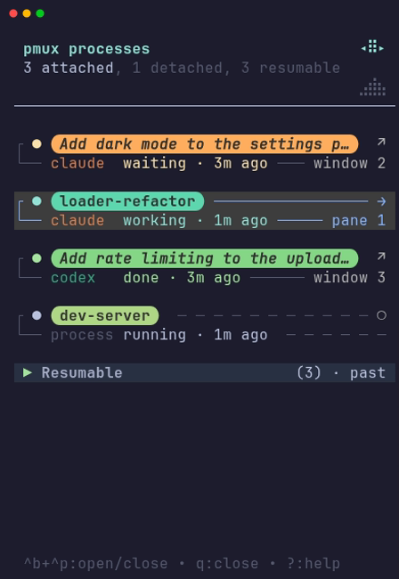
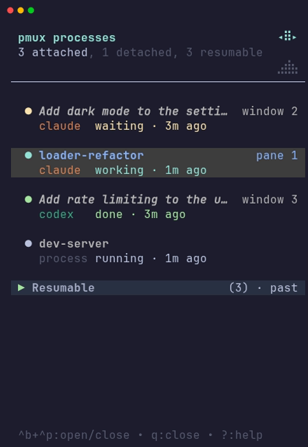
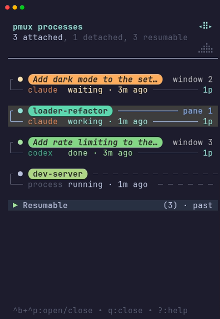
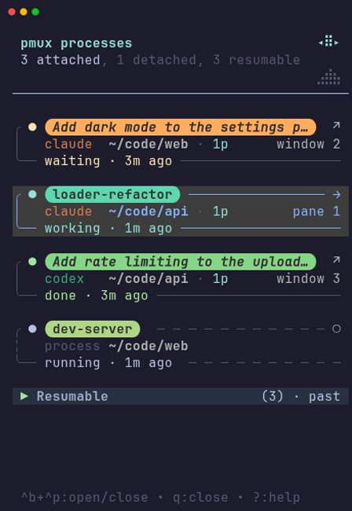
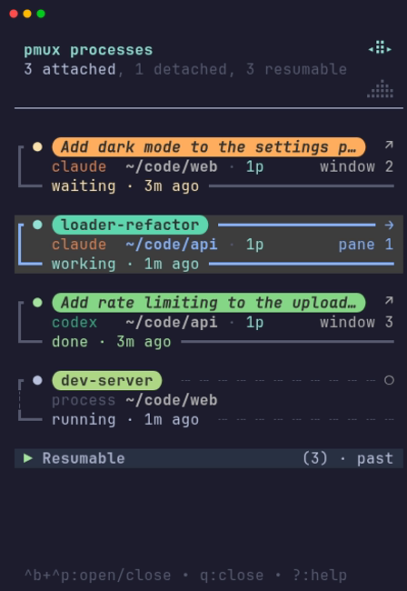
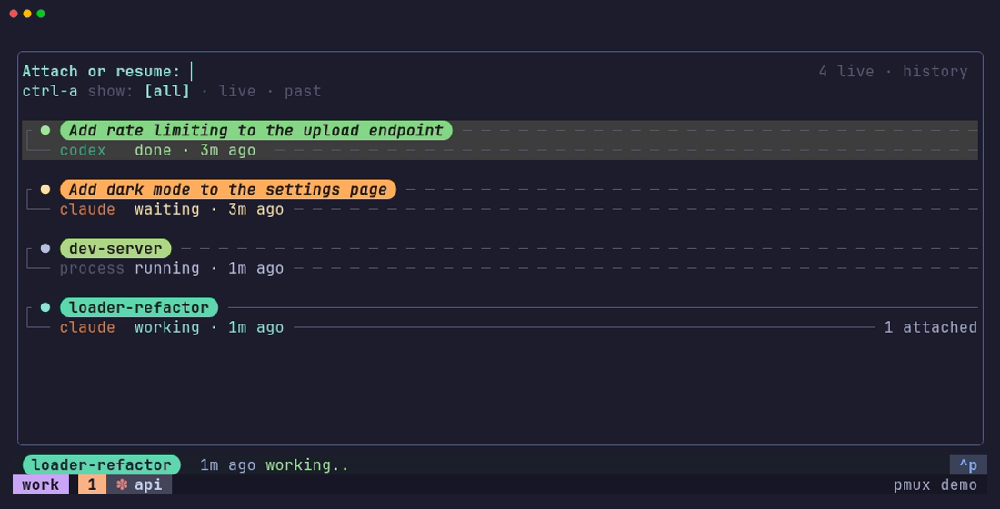
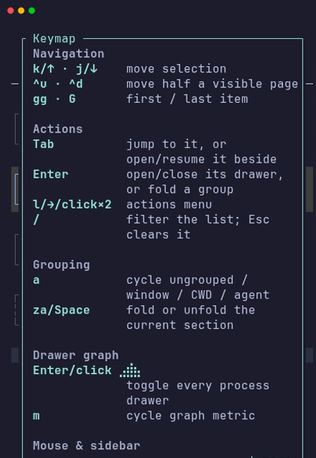

# Customizing the sidebar and picker

How the [sidebar](sidebar.md) and the attach picker show your processes, and
which keys they answer to, are set in one file,
`~/.config/pmux/config.toml`:

| Table | Sets |
| --- | --- |
| `[rows]` | process rows in both the sidebar and the picker: a preset, which details go on which line, colors, and the outline |
| `[sidebar.rows]`, `[picker.rows]` | the same, for just one of them |
| `[keys]` | keys in both the sidebar and the picker |
| `[sidebar.keys]`, `[picker.keys]` | the same, for just one of them |

Changes take effect the next time the sidebar or the picker opens; press
`prefix + Ctrl-p` twice to reopen the sidebar. A setting pmux cannot use is
reported in the sidebar's footer, or beside the picker's count, and the rest
still apply.

Every screenshot below is the example just above it, rendered by pmux in a
real tmux; [`scripts/screenshots.py`](../scripts/screenshots.py) makes them.

## Presets

A preset is a complete row design: which details each row shows, on which
lines, the outline around them, and whether names sit in colored pills.

| Preset | Rows |
| --- | --- |
| `pmux` | four lines in a box: the name, then the agent and directory, then the state and ages, then the launch directory when it has changed. The default. |
| `compact` | two lines in a box: the name, then the agent, its state, and where it is attached |
| `herdr` | two lines with no box or name pills, like [herdr](https://github.com/ogulcancelik/herdr)'s sidebar: the name and window, then the agent and its state |

Each preset also ends with a `parent` line on a row that is not drawn under
the process that spawned it, such as one whose parent is on another machine.

<!-- example: preset-pmux -->
```toml
[rows]
preset = "pmux"
```

<details>
<summary>Screenshot: the pmux preset</summary>


</details>

<!-- example: preset-compact -->
```toml
[rows]
preset = "compact"
```

<details>
<summary>Screenshot: the compact preset</summary>



</details>

<!-- example: preset-herdr -->
```toml
[rows]
preset = "herdr"
```

<details>
<summary>Screenshot: the herdr preset</summary>



</details>

### Picking a preset

The first time you run `pmux init` in a terminal, it asks which preset to
use and saves your answer in `config.toml`. To answer in advance, or when
setting up without a terminal, pass it:

```sh
pmux init --preset compact
```

### Changing your preset

`pmux preset` lists the presets and marks the one in use; `pmux preset NAME`
switches to another:

```sh
$ pmux preset
* pmux     four lines in a box: name, agent and directory, state and ages, launch directory
  compact  two lines in a box: name, then agent, state, and where it is attached
  herdr    two lines with no box or pills, like herdr's sidebar: name and window, then agent and state
$ pmux preset herdr
Rows use the herdr preset (set in ~/.config/pmux/config.toml). Reopen the sidebar to see it.
```

It changes only the `preset` line under `[rows]`, adding the table if
there is none, so the rest of your config stays as it was. You can also
edit that line yourself. Everything in the sections below layers on top of
the preset, so you can start from the one closest to what you want and
change only what differs.

## Choosing what rows show

`lines` replaces the preset's lines with your own. Each line lists tokens
from the left; the tokens after `>` are pinned to the right edge:

<!-- example: lines -->
```toml
[rows]
lines = [
  ["state_dot", "title", ">", "location"],
  ["agent", "status", "age", ">", "prompts"],
]
```

<details>
<summary>Screenshot: custom lines</summary>



</details>

| Token | Shows |
| --- | --- |
| `state_dot` | the status dot; first on a line, it sits in the row's gutter |
| `title` | the process's name, or its agent's conversation title, in a pill; with neither, its directory, unless the layout shows `cwd` elsewhere |
| `agent` | the agent kind, or `process`, padded so the next token lines up across rows |
| `cwd` | the working directory |
| `prompts` | the agent's prompt count, such as `12p` |
| `location` | where it is attached: `pane 2`, `window 3`, `2 attached` |
| `arrow` | the arrow toward where it is attached (sidebar only) |
| `status` | the agent state, or `running` |
| `age` | how long ago the state changed: `20m ago` |
| `lifetime` | how long the process has run: `1h old`, once it ran 10 minutes before its state last changed |
| `launched_in` | `Launched in: …`, when the process has since changed directory |
| `parent` | `from lead`, the process that spawned this one, when the row is not drawn under it (sidebar only) |

Tokens are joined by ` · `. A token with nothing to show is skipped along
with its separator, and a line is left out only when the process can never
fill it (`launched_in` for a process that has not moved, or `parent` for
a row drawn under its parent), so rows keep
their height while details such as prompt counts load.

When a line is too narrow for everything on it, `title`, `cwd`,
`launched_in`, or `parent` shrinks first, to no less than 8 columns; then the
pinned-right tokens are dropped, then tokens from the right end of the
line, and finally the line is cut short. Put what matters most first.

## Colors

`colors` sets a color for any token, and for `separator`, the ` · ` between
tokens of different colors. A color is a terminal color name (`cyan`,
`lightblue`, `darkgray`, `default`), a 256-color index (`0` to `255`), or
hex (`#89b4fa`, or the short `#8bf`):

<!-- example: colors -->
```toml
[rows.colors]
cwd = "#89b4fa"
prompts = 213
separator = "blue"
```

<details>
<summary>Screenshot: custom colors</summary>


</details>

Without one, each token keeps its own color, and some of those carry
meaning: `status`, `age`, and `lifetime` are colored by the agent's state,
and `cwd` by where the process is attached. A color you set replaces that,
and one set for `title` gives every pill that color. A flashing row still
flashes.

### Name pills

The `pmux` and `compact` presets draw each process's name in a pill with a
color of its own; `herdr` draws it as bold text in the row's color.
`pills` overrides the preset either way:

```toml
[rows]
preset = "compact"
pills = false
```

Without pills, a color set for `title` colors the name's text.

## Outline

`outline` sets the box around each row. `style` picks a set of glyphs:
`box` (the default), `rounded`, `heavy`, `ascii`, or `none`:

<!-- example: outline-rounded -->
```toml
[rows.outline]
style = "rounded"
```

<details>
<summary>Screenshot: the rounded outline</summary>



</details>

Any glyph can be set on its own, on top of the style:

<!-- example: outline-glyphs -->
```toml
[rows.outline]
style = "heavy"
side_detached = "┊"
rule_detached = " ┄"
```

<details>
<summary>Screenshot: heavy outlines with dotted edges for detached processes</summary>



</details>

| Glyph | Where | `box` |
| --- | --- | --- |
| `top` | the first line's corner | `┌` |
| `bottom` | the last line's corner | `└` |
| `side` | the edge between them | `│` |
| `side_detached` | that edge for a process attached nowhere | `╎` |
| `rule` | the rule after the first and last lines' content | `─` |
| `rule_detached` | that rule for a process attached nowhere, tiled | ` ─` |

Corners and edges are one character each; a rule is one to eight, repeated
to fill the line. Every character must be one column wide. The same glyphs
outline a row's open drawer and the sidebar's past sessions.

## The sidebar and the picker separately

`[rows]` applies to both. `[sidebar.rows]` and `[picker.rows]` take the
same settings for one of them, on top of `[rows]`:

<!-- example: picker-compact -->
```toml
[picker.rows]
preset = "compact"
```

<details>
<summary>Screenshot: the picker with compact rows</summary>



</details>

- A table that sets `preset` or `lines` decides that view's lines, whatever
  `[rows]` says about them.
- Colors add up: the view's own colors, then `[rows]`'s, then the token's
  own.
- Outline glyphs add up the same way, except that a view's own `style`
  starts its outline over from that style.

## Keys

Press `?` in the sidebar for its keys; [The pmux sidebar](sidebar.md#keys)
lists the defaults and their action names. `[sidebar.keys]` rebinds any of
them. Name an action and give it a key or a list of keys; every action you
leave out keeps its defaults:

<!-- example: keys -->
```toml
[sidebar.keys]
fold_section = ["za", "space"]  # replaces z
menu = ["l", "right"]           # vim-style; replaces the inward arrow
cycle_scale = []                # unbound
```

<details>
<summary>Screenshot: the keymap with these keys</summary>



</details>

An action you set gets exactly the keys you give it. A key you give one
action is taken from any default that used it (binding `a` to
`cycle_metric` leaves `cycle_grouping` with no key), and so is a default
that starts with it (binding `g` drops the default `gg`). Keys are written
as:

- a character, or several typed in a row: `z`, `G`, `?`, `gg`, `za`
- a named key: `enter`, `tab`, `esc`, `space`, `up`, `down`, `left`, `right`,
  `pageup`, `pagedown`, `home`, `end`, `backspace`, `delete`, `f1`…`f12`
- with Ctrl or Alt: `C-d`, `ctrl-d`, `<C-d>`, `M-x`, `alt-x`
- a sequence separated by spaces: `<C-w> j`

The keymap shows your keys.

### The picker's keys

`[picker.keys]` rebinds the attach picker the same way. Its actions are:

| Default | Action |
| --- | --- |
| `↑` / `Ctrl-p`, `↓` / `Ctrl-n` | move the selection (`move_up`, `move_down`) |
| `Enter` | attach the selected process, or resume the past session (`open`) |
| `Ctrl-a` | cycle which rows are listed: all, live, past (`cycle_filter`) |
| `Backspace` | delete the query's last character (`delete_char`) |
| `Esc` / `Ctrl-c` | close the picker (`close`) |

Every character you type goes into the filter, so the picker refuses a key
that starts with one (`j`, `space`) and asks for a named key or one with
Ctrl or Alt instead. `close` always keeps a key: if you leave it with none,
the picker keeps `Esc`.

```toml
[picker.keys]
move_up = ["up", "C-k"]
move_down = ["down", "C-j"]
open = ["enter", "tab"]
```

### Both at once

`[keys]` sets keys for the sidebar and the picker together, the way `[rows]`
does for rows. The two share action names where they do the same thing
(`move_up`, `move_down`, `open`, `close`); an action only one of them has,
such as `fold_section`, applies to just that one. A view's own table decides
any action it names, and `[keys]` covers the rest:

```toml
[keys]
move_down = ["j", "down", "C-j"]  # the picker leaves out j, which types
move_up = ["k", "up", "C-k"]
close = ["q", "esc"]              # the picker gets esc

[picker.keys]
open = ["enter", "tab"]           # Tab already opens in the sidebar
```

The picker quietly leaves out `[keys]` keys that would type into its
filter. An entry with no other key, such as `move_up = "k"`, leaves the
picker's defaults for that action alone.

## More

- Which side the sidebar opens on, and whether opening it takes focus, are
  tmux options: see [The pmux sidebar](sidebar.md) and
  [Integrating pmux with your tmux](tmux-integration.md#sidebar-options-and-the-equalize-key).
- pmux's own tmux server, its status line and theme, is customized
  separately: see [Customizing pmux's tmux server](customization.md).
- `[restore]` in the same file configures
  [cross-restart restoration](restore.md).
